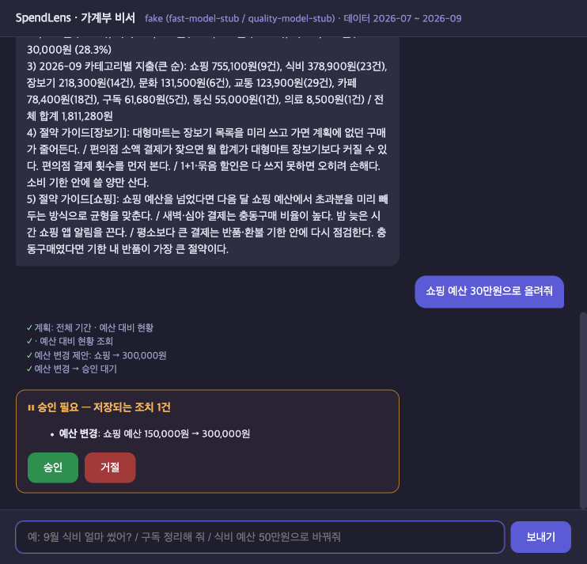

# SpendLens — 카드 내역 지출 분석·절약 코칭 AI 에이전트

AI 서비스 Mini-Project **과제 2번(신규 AI Agent)**.
카드 사용 내역에 대한 질문("9월 식비 얼마 썼어?", "구독 정리해 줘", "이상한 결제 있어?")에 **코드가 계산한 정확한 숫자**로 답한다. 절약 방법은 가이드 문서를 근거로 제안하고, 예산 변경 같은 저장 조치는 **사람 승인 후에만** 실행한다.

- **보고서 (주제 → 구조 → Before/After → 한계):** [`doc/REPORT.md`](doc/REPORT.md)

## 한눈에 보기 (같은 질문 12개, 실측)

| 지표 | Before: CSV를 LLM에 통째로 (qwen3:8b) | After: SpendLens 최종 코드 (로컬 qwen3) | After: 최종 코드 (OpenAI) |
|---|---|---|---|
| 정답률 | 2/12 | **12/12** | **12/12** |
| 지어낸 금액이 섞인 답변 | 6 | **0** | **0** |
| 하지 않은 조치를 했다고 답함 | 1 | **0** | **0** |
| 총 소요 | 80.2초 | **69.7초** | **17.3초** |
| 프롬프트 토큰 | 131,600 | **7,765** (94.1% ↓) | 6,355 |

- 결과 파일: `before_naive`, `after_local_polished`, `after_openai_polished` (`eval/results/`).
- 프롬프트·사실 텍스트를 다듬기 전 코드(`d8c95ed`)로 잰 로컬 결과는 45.4초·6,161 토큰이었다(`after_agent.json`). 다듬은 뒤 답이 길어져 느려졌다.
- OpenAI 12/12는 #7 채점 수정(구독 합계 116,680원·61,680원 두 값 인정) 뒤의 결과다. 수정 전 첫 OpenAI 측정은 11/12였다.
- 같은 프롬프트끼리 비교하면 로컬 45.4초 → OpenAI 17.8초(약 2.5배), 최종 코드끼리는 69.7초 → 17.3초(약 4배)다. OpenAI에선 마크다운이 섞인 답과 분류 오류가 0이 된다. 자세한 비교는 보고서 3-1절에 있다.



## 구조

```
route ─┬─ chat_answer / refuse(투자 등 범위 밖)
       └─ plan ─┬─ no_data(없는 달) / clarify(예산 변경 정보 부족)
                └─ categorize(미분류 가맹점 LLM 분류) → research(MCP Tool 동시 요청, 처리는 차례로)
                     ├─ advise(절약 가이드 RAG) → write ⇄ validate(금액 근거 검사) → finalize
                     └─ propose_change → approval(사람 승인, 승인 시 set_budget Tool 호출) → finalize
```

LangGraph · MCP(Tool 11개, Resource 1 · Prompt 1) · RAG(TF-IDF) · Human-in-the-loop(interrupt) · 요약 메모리 · FastAPI SSE · Vue · pytest

- **라우팅은 대부분 코드가 한다.** 측정한 12문항 중 11개는 코드가 경로를 정했고, 신호가 없는 잡담(#11)만 0.6b가 라우팅했다.
- **MCP Tool 호출:** research는 `asyncio.gather`로 함께 보내지만, `agent/mcp_client.py`가 stdio 세션 하나를 `asyncio.Lock`으로 감싸므로 MCP 서버는 한 번에 하나씩 처리한다.
- **MCP Resource·Prompt:** 에이전트는 Resource를 읽지 않는다. RAG는 `data/guides/*.md`를 직접 읽는다(`agent/guide_retriever.py`). Prompt는 코드가 의도를 못 찾았을 때만 가져오며, 측정 12문항에서는 한 번도 쓰이지 않았다.

## 실행

```bash
bash sh/setup_venv.sh                       # 최초 1회
.venv/bin/python3 -m pytest -q              # LLM 없이 테스트
ollama pull qwen3:0.6b && ollama pull qwen3:8b
LLM_BACKEND=ollama bash sh/run_agent.sh     # 백엔드 http://127.0.0.1:8200
bash sh/run_frontend.sh                     # 채팅 화면 http://localhost:8700 (다른 터미널)
```

- `LLM_BACKEND`: `fake`(기본, 네트워크 없음) · `ollama` · `openai`(과금)
- `HITL_APPROVAL=0`: 예산 변경을 자동 승인
- **포트:** 백엔드 8200, 화면 8700. 이미 쓰고 있으면 아무것도 끄지 않고 다른 포트를 안내한다.
- **데이터:** `data/transactions.csv`는 `scripts/make_data.py`가 고정 시드로 만든 가상 내역이다(2026-07~09, 268건). 실행 중 바뀌는 값(LLM 분류, 승인된 예산)은 `data/runtime/`에 저장되고 git에는 올라가지 않는다.

## 측정

```bash
.venv/bin/python3 eval/naive_baseline.py --label before_naive   # Before
.venv/bin/python3 eval/bench.py --label after_agent             # After (백엔드 필요)
.venv/bin/python3 eval/compare.py before_naive after_agent
.venv/bin/python3 eval/classify_eval.py                         # 가맹점 분류 0.6b vs 8b
```
