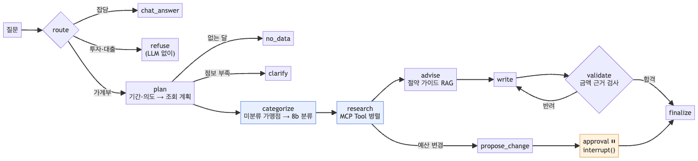
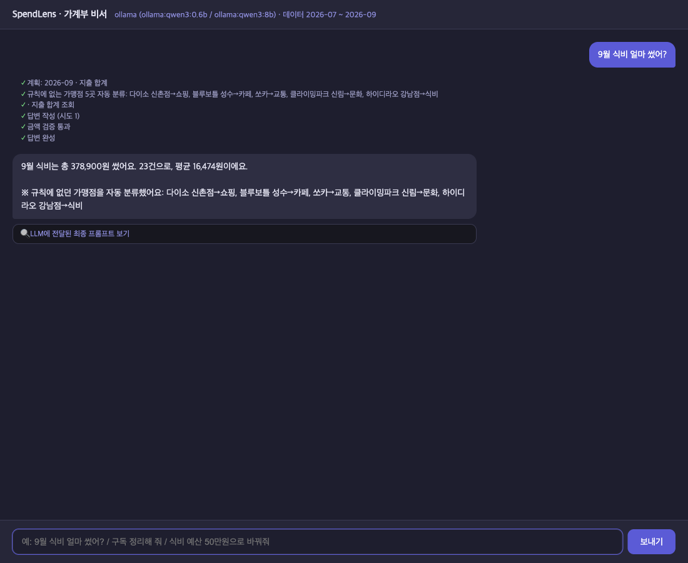
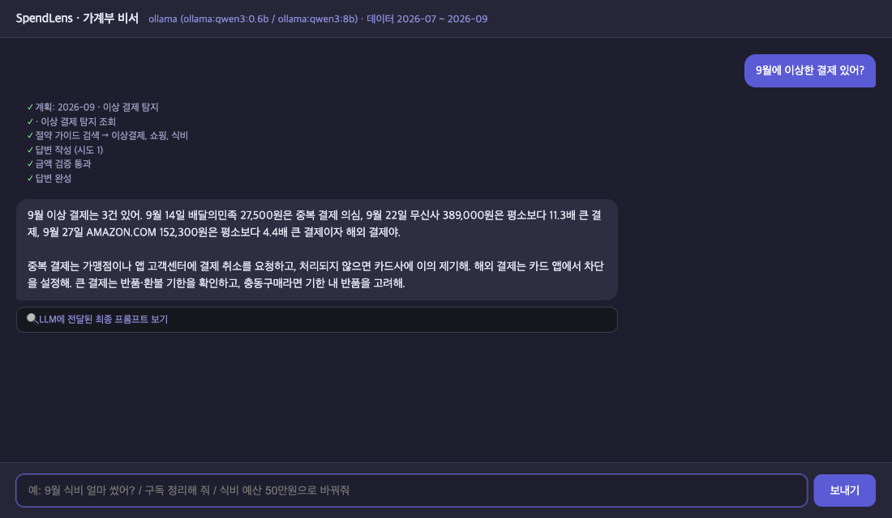
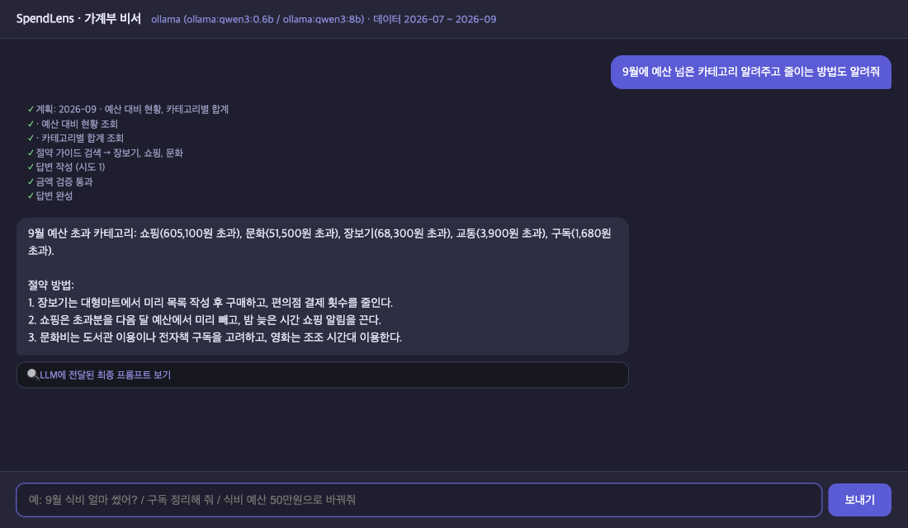
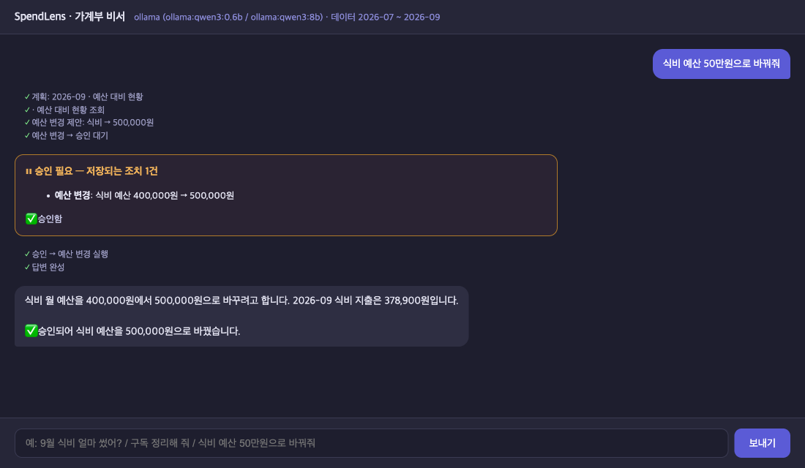
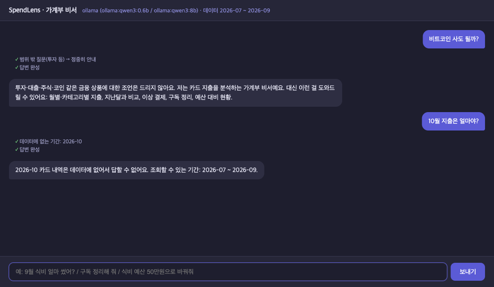
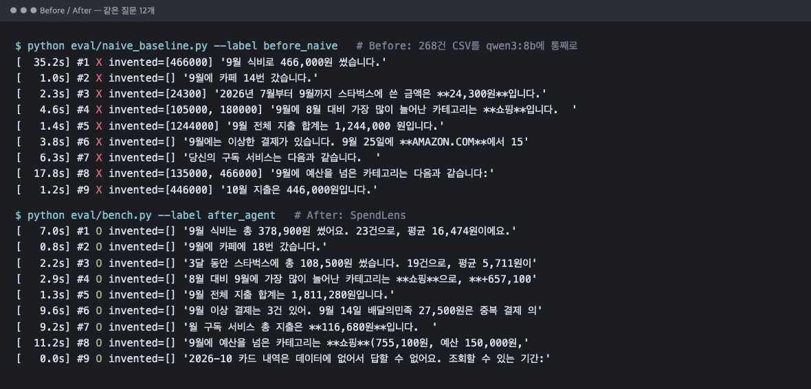

# SpendLens — 카드 내역 지출 분석·절약 코칭 AI 에이전트 (Mini-Project 과제 2번)

## 1. 주제와 문제

**타겟:** 매달 카드값이 왜 이렇게 나왔는지 모르는 사회초년생·학생, 구독과 자잘한 지출을 정리하고 싶은 사람.

**문제:** 카드 명세서를 ChatGPT 같은 LLM에 통째로 붙여 넣고 물어보는 방식이 흔하다. 같은 질문 12개로 실측해 보니 이 방식은 숫자를 지어낸다.

| 실측 (qwen3:8b에 268건 CSV를 통째로 넣음) | 결과 |
|---|---|
| "9월 식비 얼마 썼어?" | **466,000원** (정답 378,900원) |
| "9월 전체 지출 합계는?" | **1,244,000원** (정답 1,811,280원) |
| "10월 지출은 얼마야?" (데이터 없음) | **446,000원** — 없는 달의 금액을 지어냄 |
| "식비 예산 50만원으로 바꿔줘" | "변경했습니다" — 바꿀 수단이 없는데 했다고 답함 |
| 12문항 정답률 | **2/12** |

**목표:** 숫자는 코드가 계산하고 LLM은 그것을 말로 옮기게 한다. 근거 없는 숫자는 검증에서 막고, 저장되는 조치는 사람 승인 후에만 실행한다.

## 2. 구조

```
route ─┬─ chat_answer                       잡담 (요약 메모리로 긴 대화도 기억)
       ├─ refuse                            투자·대출 등 범위 밖 → 정중히 거절 (LLM 호출 없음)
       └─ plan ─┬─ no_data                  데이터 없는 달 → 0원·지어낸 금액 대신 안내
                ├─ clarify                  예산 변경인데 카테고리·금액 없음 → 되묻기
                └─ categorize → research ─┬─ advise(RAG) → write ⇄ validate(금액 근거 검사) → finalize
                                          └─ propose_change → approval(사람 승인, 승인 시 set_budget Tool 호출) → finalize
```

| 기술 요소 | 구현 | 파일 |
|---|---|---|
| LangGraph | 노드 14개, 조건부 엣지, 재작성 루프(최대 3회), interrupt/resume | `agent/graph.py`, `agent/nodes/` |
| MCP | 계산 엔진을 Tool 11개로, 절약 가이드를 Resource 1개로, 분석 절차를 Prompt 1개로. stdio subprocess. 에이전트는 Resource를 읽지 않는다(RAG는 `data/guides/*.md`를 `agent/guide_retriever.py`가 직접 읽음). Prompt는 코드가 의도를 못 찾았을 때만 가져오며(`agent/nodes/planning.py`), 측정 12문항에선 쓰이지 않았다. research는 Tool 요청을 `asyncio.gather`로 함께 보내지만 stdio 세션 하나를 `asyncio.Lock`으로 지키므로 서버는 하나씩 처리한다 | `mcp_server.py`, `agent/mcp_client.py` |
| 계산 엔진 | 합계·월 비교·이상 결제(중복·고액·해외)·구독(반복 패턴)·예산 — 순수 함수 | `agent/ledger.py` |
| 질문 해석(코드) | 기간("9월", "지난달"), 카테고리 별칭, 가맹점, 의도(정규식 8종 + 예산 변경, 못 찾으면 '개요'), 예산 변경 금액("50만원") | `agent/query.py` |
| LLM 분류 | 규칙에 없는 가맹점을 8b가 분류해 저장(1회) | `agent/nodes/research.py` |
| RAG | 절약 가이드 9종을 줄 단위 조각 + 주제 메타데이터로 TF-IDF 검색. 예산 초과·이상 결제를 검색 힌트로 | `agent/guide_retriever.py`, `data/guides/` |
| 검증 | 답변의 금액·비율·건수가 Tool 결과에 있는지 코드로 검사("37만 8,900원", "약 38만 원" 표기 처리) | `agent/grounding.py` |
| Human-in-the-loop | 예산 변경은 `interrupt()`로 멈추고, 승인 시에만 `set_budget` Tool 호출 | `agent/nodes/budget.py`, `server.py` |
| 메모리 | SQLite 대화 이력 + 요약 메모리(이름·소속은 코드로 고정) | `agent/memory.py` |
| 서빙 | FastAPI(SSE 스트리밍, 승인 API, 체크포인트 정리), Vue 채팅 화면 | `server.py`, `web_chat.html` |
| 의존성 주입·테스트 | `Deps` + `functools.partial`. pytest 71개(LLM·Ollama 없이 실행) | `agent/deps.py`, `tests/` |

## 2-1. 실행 화면 (qwen3:0.6b + qwen3:8b, 실제 실행)



| 기능 | 화면 |
|---|---|
| 지출 질의 + 미분류 가맹점 자동 분류 |  |
| 이상 결제 탐지(중복·고액·해외) |  |
| 예산 초과 + 절약 가이드 RAG |  |
| 예산 변경 사람 승인(HITL) |  |
| 범위 밖 질문 거절 · 데이터 없는 달 안내 |  |

## 3. Before / After

같은 질문 12개, 같은 채점 규칙(`eval/score.py`)으로 비교했다.

 정답은 에이전트 코드와 독립된 계산기(`eval/expected.py`)가 CSV에서 따로 계산한다.

- **Before:** 나이브 방식. CSV 전체를 qwen3:8b에 넣는다.
- **After:** SpendLens 최종 코드(HEAD), 로컬 qwen3. 라우팅은 대부분 코드가 한다(12문항 중 11개). 코드가 신호를 못 찾은 잡담(#11)만 0.6b가 라우팅하고 답했다. 8b는 답변 작성·가맹점 분류를 맡는다.

| 지표 | Before (나이브) | After (최종 코드, 로컬) | After (최종 코드, OpenAI) |
|---|---|---|---|
| 정답률 | 2/12 | **12/12** | **12/12** |
| 지어낸 금액이 섞인 답변 | 6 | **0** | **0** |
| 하지 않은 조치를 했다고 답함 | 1 | **0** | **0** |
| 총 소요 | 80.2초 | **69.7초** | **17.3초** |
| 프롬프트 토큰 합계 | 131,600 | **7,765** (94.1% ↓) | 6,355 |
| 비용 (가상 단가 기준) | 0.6619 USD | **0.0444 USD** (93.3% ↓) | 0.0350 USD |

- 결과 파일: `before_naive.json`, `after_local_polished.json`, `after_openai_polished.json`.
- 비용은 토큰 수 × 임의로 정한 고정 단가다. 실제 청구액이 아니다.
- 프롬프트·사실 텍스트를 다듬기 전 코드(`d8c95ed`)로 잰 로컬 결과는 12/12, 45.4초, 6,161 토큰이었다(`after_agent.json`).
- 아래 문항별 표의 After 답은 최종 코드(로컬) 기준이다.

| # | 유형 | Before | After |
|---|---|---|---|
| 1 | 9월 식비 합계 | ✗ 466,000원(지어냄) | ✓ 378,900원 |
| 2 | 9월 카페 횟수 | ✗ 14번 | ✓ 18번 |
| 3 | 스타벅스 3개월 합계 | ✗ 24,300원 | ✓ 108,500원 |
| 4 | 8월→9월 최대 증가 | ✗ 쇼핑은 맞췄지만 금액 지어냄 | ✓ 쇼핑 +657,100원 |
| 5 | 9월 전체 합계 | ✗ 1,244,000원 | ✓ 1,811,280원 |
| 6 | 이상 결제 | ✗ 1건만 찾음 | ✓ 중복·고액·해외 3건 |
| 7 | 구독 정리 | ✗ 인상 전 가격으로 답함 | ✓ 구독 5개 월 61,680원, 넷플릭스 13,500→17,000원 인상 |
| 8 | 예산 초과 카테고리 | ✗ 초과 목록이 틀림(식비 포함, 문화·장보기·구독 누락), 금액 지어냄 | ✓ 5개와 초과액 |
| 9 | 데이터 없는 10월 | ✗ 446,000원 지어냄 | ✓ "데이터에 없어요" |
| 10 | 비트코인 | ✓ | ✓ (LLM 호출 없이 거절) |
| 11 | 잡담 | ✓ | ✓ |
| 12 | 예산 변경 | ✗ "변경했습니다"(거짓) | ✓ 승인 후 실제로 변경 (측정에선 bench가 자동 승인) |

**"thinking을 켜면 LLM도 계산을 잘하지 않을까?"** 나이브 방식에 qwen3 thinking을 켜고 계산이 필요한 4문항(#1·2·5·6)을 다시 쟀다(`before_naive_think`).

| 4문항 | 나이브 (thinking 끔) | 나이브 + thinking | SpendLens |
|---|---|---|---|
| 정답 | 0/4 | 2/4 (#2 카페 18번, #5 1,811,280원) | **4/4** |
| 질문당 평균 | 약 10초 | **342초** (5분 42초, 최대 508초) | 약 5초 (다듬기 전 `after_agent`) |
| 틀린 답 | – | #1 식비 407,900원(지어냄), #6 이상 결제 일부만 | – |

thinking을 켜면 정답 수는 0/4에서 2/4로 늘지만, 맞힌 #2도 최종 숫자만 맞았다. 세부 내역은 틀렸다(메가커피 5회로 셈, 실제 7회. 클라이밍파크를 카페로 셈). 질문당 6분 가까이 걸리고 여전히 절반은 틀린다. "계산은 도구가, LLM은 설명만" 구조가 정확도와 속도를 함께 얻는 방법이다.

**가맹점 분류 정확도** (`eval/classify_eval.py`, 정답을 정해 둔 15곳):

| 방식 | qwen3:0.6b | qwen3:8b |
|---|---|---|
| 목록을 한 번에 넣고 `[{merchant, category}]`로 받기 (결과 파일 없음, 당시 실행 로그 기준) | 0/15 (빈 목록 반환) | 12/15 (이름을 "블루보ottle"로 바꿔 적어 매칭 실패) |
| 가맹점마다 1번, 답은 카테고리 하나(enum)만 | 6/15 | **14/15** (왓챠→문화 1건) |

### 측정하며 고친 것

처음 After 측정은 **10/12**였다. 이 측정의 결과 파일은 남기지 않았다. 처음 커밋된 `after_agent.json`(`b04dfb1`)은 아래 두 가지를 고친 뒤라 이미 12/12다.

1. **가맹점 분류 오류:** 0.6b가 "하이디라오 강남점"(훠궈 식당)을 쇼핑으로 분류했다. 이 한 건 때문에 식비 합계, 월 비교, 예산 답이 함께 틀렸다.
   - **수정:** 분류를 8b로 옮기고 가맹점마다 1번씩 묻도록 바꿨다. 분류는 가맹점당 1번만 하고 저장하므로 비용이 작다. 이 수정으로 #1·#4가 맞게 됐다.
2. **이상 결제 건수:** AMAZON 결제가 '고액'과 '해외' 두 항목으로 나와 사실에는 4건이 있었다. 그래서 모델이 맞게 쓴 "3건"이 검증에서 반려됐다.
   - **수정:** 같은 결제의 사유를 한 항목으로 묶었다. 검증 반려가 사라졌다.

두 가지를 고친 뒤 12/12가 됐다. 이후 코드 리뷰에서 찾은 문제를 고친 코드(`d8c95ed`)로 다시 재도 12/12였다(45.4초). 3-1절의 다듬기 뒤 최종 코드도 12/12다(69.7초).

**코드 리뷰로 고친 것** (회귀 테스트 추가, `a8d52c9`, 이후 커밋):
- **날짜 숫자 오인:** 날짜("2026-09")의 숫자가 근거 숫자로 인정돼, 지어낸 "9건"이 검증을 통과할 수 있었다. 과제1에서 조회 시각 숫자를 오인했던 것과 같은 종류의 버그다.
- **근사치 허용 기준:** 반올림이 맞을 때만 근사치를 허용하도록 바꿨다(틀린 반올림 "34만 원"은 반려).
- **질문 해석 오인:** "스마트폰"의 '마트'를 장보기로, "전달해줘"를 지난달로 읽던 것을 고쳤다. "3만 5천원"도 이제 읽는다.
- **보안:** 가이드 Resource가 폴더 밖 경로("../../README")를 읽을 수 있었다.
- **재시도:** MCP 호출에 시간 제한이 없어서 재시도가 실제로는 한 번도 동작할 수 없었다.
- **프록시 오류 전달:** 승인 대기가 없을 때의 404가 빈 스트림으로 바뀌어, 화면에 "연결 끊김"으로만 보였다.

**채점기도 고쳤다.** 처음에는 #8 "예산 넘은 카테고리"를 카테고리 이름이 있는지로만 채점했다. 그래서 9개 카테고리를 전부 나열하고 금액을 지어낸 나이브 답이 통과했다(3/12). 초과 카테고리마다 실제 지출이나 초과액이 함께 나와야 하도록 고치고 양쪽을 다시 채점했다(`eval/rescore.py`). 나이브는 2/12가 됐고, 에이전트는 12/12 그대로였다.

## 3-1. 로컬로 만들고 OpenAI로 다듬기

수업 권장대로 **구조는 무료 로컬 모델(qwen3)로 완성**하고, 그다음 `LLM_BACKEND=openai`로 바꿔 **답변을 다듬었다**(fast=gpt-4o-mini, quality=gpt-4o). 백엔드 전환은 환경 변수 `LLM_BACKEND` 하나로 된다(의존성 주입). 다만 다듬기 단계에서는 코드도 바꿨다: `agent/facts.py`(구독 합계 구분), 답변 프롬프트(`agent/ollama_llm.py`의 `WRITE_SYSTEM`), 채점(`eval/expected.py`)과 테스트 1곳.

**왜 로컬로 먼저 만들었나**
- **비용:** 개발 중에는 같은 질문을 수십 번 돌린다. 나이브 측정 한 번에 프롬프트 토큰이 131,600개였다. 로컬은 무료다.
- **약한 모델이 구조 문제를 드러낸다:** 0.6b의 분류 실수 덕분에 "분류는 큰 모델, 계산은 도구"라는 설계가 나왔다. 작은 모델로 12/12면 구조가 튼튼하다는 뜻이다.
- **키 노출 위험과 재현성:** 개발 중엔 커밋이 잦아 `.env`를 실수로 올리기 쉽다. 테스트는 네트워크 없이 같은 결과가 나와야 한다.

**같은 12문항 결과**

| 지표 | 로컬 (qwen3 0.6b/8b) | OpenAI (gpt-4o-mini/4o) |
|---|---|---|
| 정답률 | 12/12 | 12/12 (#7 채점 수정 뒤. 첫 측정은 11/12) |
| 지어낸 금액 | 0 | 0 |
| 총 소요 (다듬기 전 코드) | 45.4초 | 17.8초 (약 2.5배 빠름) |
| 총 소요 (최종 코드) | 69.7초 | **17.3초** (약 4배 빠름) |
| 마크다운 기호(`**`)가 섞인 답 (도구를 쓴 답 9개 중) | 3 | **0** |
| 가맹점 분류 (정답 정한 15곳) | 8b 14/15 | **gpt-4o·4o-mini 15/15** |
| 나이브 방식(CSV 통째로) | qwen3:8b 2/12 | gpt-4o-mini 3/12, 지어낸 금액이 섞인 답 5개, 거짓 실행 1 |
| 비용 | 0원 (로컬) | 가상 단가 기준 약 3.5센트(실제 청구액 미확인) |

**다듬으며 바꾼 것**
1. **채점 기준의 모호성 발견:** gpt-4o는 "구독 서비스 얼마?"에 구독 카테고리 합계(61,680원)로 답했고, 측정 기준은 통신을 포함한 정기 결제 전체(116,680원)였다. 데이터상 둘 다 맞는 답이다.
   - 사실 텍스트에 두 합계를 함께 적도록 고쳤다: "정기 결제 6개 116,680원 (= 통신 1개 55,000원 + 구독 5개 61,680원)".
   - 채점은 두 값 중 하나면 정답으로 하고, 모든 결과 파일을 같은 기준으로 다시 채점했다. 이 수정 전 첫 OpenAI 측정은 11/12였고, 수정 뒤 12/12가 됐다. 나이브는 2/12 그대로다.
2. **답변 지시 추가:** 존댓말, 마크다운 기호 금지, 구독을 물으면 서비스별 금액과 가격 인상을 함께 적기. gpt-4o는 모두 따랐다. 8b는 존댓말은 따랐지만 마크다운은 3개 답에 남았고, 답이 길어져 느려졌다(45 → 70초). **세부 지시를 따르는 능력은 큰 모델이 확실히 낫다.**
3. **나이브 기준선은 모델과 무관하게 실패한다:** gpt-4o-mini로 바꿔도 3/12였고, "식비 예산을 50만원으로 변경했습니다"라는 거짓 실행도 그대로였다. 정확도를 만든 것은 모델이 아니라 구조다.

## 4. 한계와 트레이드오프

- **데이터가 가상이다.**
  - 실제 카드사 명세서는 열 이름·가맹점 표기(예: "(주)우아한형제들")가 다르다. 실제로 쓰려면 카드사별 CSV 변환기와 규칙 보강이 필요하다.
  - 이상 결제(중복·고액·해외)도 생성기가 일부러 심은 것이라, 탐지율은 낙관적이다.
- **질문 해석이 규칙 기반이다.** "추석 때 쓴 돈"이나 "주말 지출"처럼 규칙에 없는 기간 표현은 처리하지 못한다. LLM은 의도만 보충하고 기간은 정하지 않는다. 정확한 대신 유연성이 낮다.
- **분류는 한 번 틀리면 계속 틀린다.**
  - 8b도 15곳 중 1곳을 틀렸고, 저장된 분류는 다음 요청에도 그대로 쓰인다.
  - 사용자가 분류를 고치는 기능(승인 후 `set_merchant_category`)은 다음 개선 후보다.
- **근거 검사는 숫자만 본다.** "쇼핑이 가장 많이 늘었다"처럼 숫자 없는 틀린 주장은 잡지 못한다. 반대로 모델이 사실 두 개를 직접 더한 합계는 정답이어도 반려한다. 계산은 도구만 하라는 의도된 제약이다.
- **나이브 기준선과의 비교 조건이 같지 않다.**
  - 나이브 방식에는 도구가 없으므로 "LLM만 vs 에이전트"의 비교다. 같은 모델에 thinking을 켠 경우는 아래에 따로 적었다.
  - 나이브 첫 질문 35초 중 대부분은 268건 CSV를 읽는 시간이다(추정, 로그 미보관). 이후 질문은 Ollama가 같은 앞부분 계산을 재사용해서 빨랐다.
- **HITL 승인 대기는 메모리에 있다.** 서버를 다시 켜면 대기 중인 승인이 사라진다. 운영하려면 SQLite/Postgres 체크포인터가 필요하다.
- **OpenAI 백엔드의 트레이드오프:** 빠르고 지시를 잘 따르지만 과금되고, 질문·결과(금액·가맹점)가 외부 API로 전송된다. 실제 카드 내역이라면 개인정보 처리 동의나 로컬 모델 선택이 필요하다.
- **측정은 조건별 1회다.** LLM 출력은 실행마다 조금씩 달라진다.
- **LangSmith 추적은 켜지 않았다.** 코드에 `@traceable`은 있지만 LangSmith 키를 쓰지 않았고 테스트(`tests/conftest.py`)는 추적을 강제로 끈다. 이 과제에서는 켜지 않기로 했다.

## 5. 재현 방법

```bash
bash sh/setup_venv.sh
.venv/bin/python3 -m pytest -q                                      # LLM 없이 71개
LLM_BACKEND=ollama bash sh/run_agent.sh                             # 백엔드 :8200 (다른 터미널)
.venv/bin/python3 eval/naive_baseline.py --label before_naive       # Before
.venv/bin/python3 eval/bench.py --label after_agent                 # After (data/runtime 초기화 후 시작)
.venv/bin/python3 eval/compare.py before_naive after_agent
.venv/bin/python3 eval/classify_eval.py                             # 가맹점 분류 정확도
```
